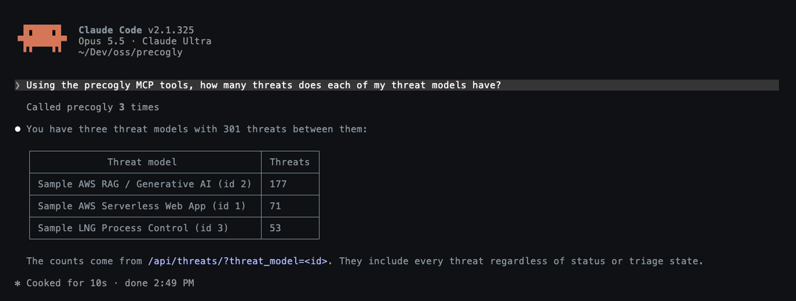
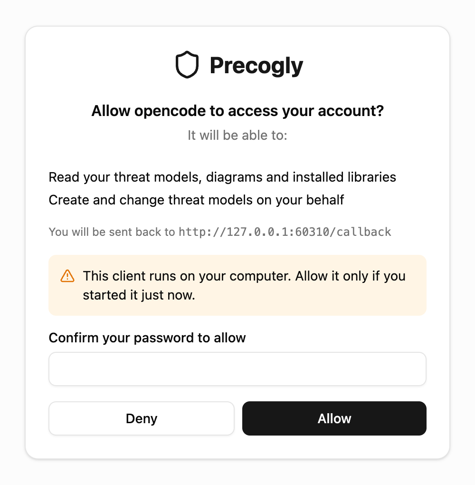

# Precogly MCP

The [Model Context Protocol](https://modelcontextprotocol.io) server built into
Precogly. It lets AI assistants such as Claude Code read and change threat models
through Precogly's REST API, acting as the user who connected them.

To connect a client, see the [MCP guide](../docs/guides/mcp.md). This README covers
how the server works and how to develop it.



## Tools

| Tool | What it does |
| --- | --- |
| `whoami` | Returns the connected user, their organizations and role in each, and the connection's scopes. |
| `search` | Runs Python the model writes over Precogly's OpenAPI schema, to find the endpoints and fields it needs. |
| `execute` | Runs Python the model writes against the API, through an async `request()` that calls it as the user. |

Rather than one tool per question, the model writes code against the API
([0012](docs/0012-code-mode-over-the-api-schema.md)). A question such as "how many
threats does each of my threat models have" is one `execute` call that pages through
every listing, where per-question tools would take one call per page.

## How it works

```text
  MCP client
     |  HTTPS, OAuth bearer token
     v
  /mcp  .................. precogly_mcp, mounted in Precogly's own process
     |
     |  search:  model's Python over the OpenAPI schema
     |  execute: model's Python calling request()
     v
  request()  ............. in-process call, no HTTP and no credential
     |
     v
  Precogly REST API ...... runs as the token's user, with that user's permissions
```

- **Mounted only.** The server runs inside Precogly at `/mcp`; there is no stdio
  transport and no separate service to deploy
  ([0013](docs/0013-the-server-is-mounted-only.md)).
- **Precogly is the authorization server.** Clients register themselves, and the user
  approves each one on a consent page in the Precogly web application
  ([0015](docs/0015-consent-is-a-page-of-the-application.md)). Tokens are checked
  against Precogly's database and must be issued for `/mcp`.
- **Read by default.** A new connection gets the `read` scope. A write without `write`
  is answered with a 403 scope challenge, and a client that supports step-up
  authorization asks the user again and retries.
- **Sandboxed code.** Model-written code runs in a sandbox; see [Sandbox](#sandbox).
- **No Django here.** Precogly supplies the token verifier, `request()` and the
  schema, so this package can be tested on its own.



## Sandbox

There are two ways to sandbox code:

- **In-language:** an interpreter that lacks the dangerous capabilities, so code can
  reach the outside only through functions the host registers.
- **Process:** ordinary Python in an operating-system process whose system calls and
  network access are restricted from outside.

This server uses an in-language sandbox,
[`pydantic-monty`](https://github.com/pydantic/monty), because the code has to reach
Precogly's API. A process sandbox could allow that only by permitting network access to
the local machine, which also reaches the PostgreSQL database beside Precogly. Monty
has no network access to misconfigure: `request()` is the code's only way out, and
Precogly runs it in-process. See [0005](docs/0005-code-execution-over-tools.md) for
the full comparison.

`request()` acts as the connected user, so the code can do only what that user can do,
and writes still need the `write` scope. The bearer token never enters the sandbox.

| Limit | `search` | `execute` |
| --- | --- | --- |
| Computation | 2 s | 2 s, not counting time spent waiting on the API |
| API calls | none | 100 |
| Total time | no separate limit | 30 s |
| Result | 24,000 characters | 24,000 characters |
| Printed output | 4,000 characters | 4,000 characters |

A result over its limit is cut while staying valid JSON, and the cut is marked.

## Layout

| Path, from the repository root | Contents |
| --- | --- |
| `mcp/src/precogly_mcp/server.py` | Builds the server and the ASGI app Precogly mounts. |
| `mcp/src/precogly_mcp/tools.py` | The three tools, their descriptions and limits. |
| `mcp/src/precogly_mcp/spec.py` | Reduces the OpenAPI schema for `search` and inlines every `$ref`. |
| `mcp/src/precogly_mcp/scope_challenge.py` | Turns a write refused for lacking `write` into a 403 scope challenge. |
| `mcp/src/precogly_mcp/truncate.py` | Cuts a JSON result to a character budget and keeps it valid. |
| `backend/config/mcp_mount.py` | Serves this ASGI app from Precogly's WSGI application. |
| `backend/apps/core/mcp/` | Precogly's side: the token verifier, `request()`, the schema and the errors the model sees. |
| `backend/apps/oauth/` | The consent flow and the Authorized applications settings API. |

## Development

Run these from this directory. uv installs this package's dependencies only, so Django
stays out even though it shares the repository's lock file.

```bash
uv run pytest              # tests
uv run ruff check .        # lint
uv run ruff format .       # format
uv run mypy src            # type-check (strict)
uv run pip-audit           # scan dependencies for known vulnerabilities
```

Install the repository's git hooks once, from the root, with
`uv run pre-commit install`.

The tests need no running Precogly. `mcp.client.Client` drives the server over
in-memory streams, so tools are listed and called as a real client would, and a fake
`request` stands in for the API; the sandbox is real. The backend's
`apps/core/tests/test_mcp_*` tests run the tools against the real schema and API.

The fake `request` cannot catch a change in what the API returns or in how tools reach
it. Run such changes against a seeded local stack (`docker compose up`) before merging.

## Design records

Each design decision is a numbered record in [`docs/`](docs/), linked above where it
applies. A record's status line says whether a later one superseded it.
